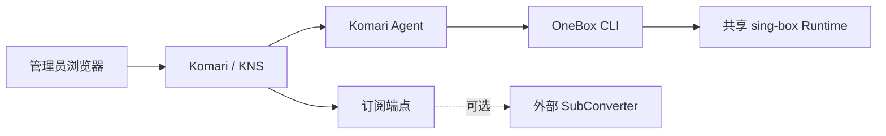

# Komari KNS：OneBox 节点与订阅

Komari KNS 是 Komari 的节点管理与订阅插件。你可以在一个页面里查看机器、管理 OneBox 节点、检查远程任务，并为不同客户端生成订阅链接。

[🖥️ 工作台](#workbench) · [🚀 安装](#install-node) · [🔄 接管](#claim-node) · [📋 任务](#task-status) · [🔗 订阅](#subscriptions) · [🛡️ 安全](#security)

## 🔌 OneBox 项目介绍

OneBox 负责在 Linux 机器上安装和运行代理节点；KNS 通过 Komari 集中管理这些节点并生成订阅。请查看 [OneBox 项目介绍与使用文档](https://github.com/liuarui/onebox)。

> 下方是操作示意图。订阅地址、机器地址和节点凭据请勿公开分享。

## 🚀 快速开始

1. 从 [GitHub Releases](https://github.com/liuarui/komari-plugin-kns/releases) 安装插件包并在 Komari 中启用。
2. 首次打开时填写探针可访问的 Komari HTTPS 地址。
3. 在机器页面完成远程安装授权、只读扫描和节点安装。
4. 创建订阅档案并选择客户端格式，核对机器、协议和节点筛选。

## 🖥️ 工作台

机器按 Komari 服务器列表排序。你可以按在线状态、OneBox、协议和机器标签筛选，也可以切换三列卡片、单列卡片或紧凑列表。机器从 Komari 删除后，KNS 同步清除其机器和节点记录，节点也会从订阅中移除；这不会卸载远程机器上的 OneBox。

## 🧩 安装细节

在机器页面选择一台或多台在线机器，再选择协议、监听端口和连接入口。检查公网地址、NAT 外部端口和协议映射后提交。

远程安装授权默认开启；KNS 不会在你确认前自行部署。确认安装节点时，如果目标机是全新环境，KNS 会先安装所需依赖、sing-box 和初始配置，再继续安装所选节点。已有配置会先检查；配置路径异常或缺少必要结构时会停止，不会用空白配置覆盖已有文件。NAT 外部端口只用于生成订阅；还需要在路由器或云网络中配置公网端口到机器监听端口的转发。KNS 不会修改云安全组、路由器、DNS 或外部转发。

## 🔄 接管已有 OneBox 节点

在机器卡片上扫描已有节点。对受支持的旧节点选择“接管”，KNS 会保留节点协议、端口、凭据和 TLS 设置，将入站 tag 迁移为 KNS 管理的 tag，并登记实例清单。接管前会显示确认说明；操作会重载共享 sing-box 服务，同机其他节点可能短暂重连。配置校验、服务重载或回调失败时，OneBox 会尝试恢复原配置。

接管完成后可以在 KNS 中重配置、启停、重装、核查和卸载节点。多用户节点、不完整配置和不受支持的入站会显示原因，不会被自动改写。

## 📋 任务状态

“操作记录”和机器卡片会显示 Agent 执行、OneBox 回调与远端状态核验结果。任务显示“已提交”只表示 Komari 已接收请求；请等状态变为成功或失败后再继续操作。结果不确定时，先核查机器状态。

## 🔗 订阅链接

创建订阅档案后，可以设置包含或排除的机器、协议和节点标签，决定是否过滤不健康节点，并选择输出格式。KNS 内置生成 URI、Mihomo YAML、sing-box JSON、Loon、Surge / Surfboard、Quantumult / Quantumult X、Stash、Mellow、Shadowrocket、V2RayN / V2RayNG、Shadowsocks、SSD 等常用订阅；其中部分客户端格式使用 Base64 URI 列表或 Mihomo YAML。无需外部 SubConverter 也能生成内置格式。新建或接管节点的默认名称为“旗帜国家-机器名-协议-端口”，例如 `🇭🇰香港-hytron hk-VLESS Reality-443`；手动命名和升级前已登记的节点保留现有名称。

外部 SubConverter 仍可作为额外 target 使用；Clash 的默认、ACL4SSR 轻量和 ACL4SSR 完整规则模板由当前配置的 SubConverter 服务提供。

订阅令牌可以关闭、重新开启或轮换。每个档案仅有一个有效令牌，轮换后旧链接立即失效。无需令牌的档案适合公开分发：任何持有链接的人都能读取订阅。

外部 SubConverter 会收到原始订阅 URI 和节点凭据。请只配置自己信任的 HTTPS 转换服务；留空即可只使用 KNS 原生订阅。

## ⚙️ 高级参数

安装向导的协议卡片提供高级参数，按协议显示：

- 通用：ALPN、跳过证书校验
- VLESS Reality：可选 SNI、flow、客户端指纹、SpiderX、Reality 握手域名/端口
- Hysteria2：上行/下行 Mbps、obfs、obfs 密码
- VMess：alterId、加密方式
- TUIC：拥塞控制、UDP Relay 模式
- Trojan / AnyTLS：ALPN、跳过证书校验
- Shadowsocks：加密方法

高级参数区会显示当前非默认配置摘要，并提供“恢复默认”。OneBox 适配器会校验参数类型和范围，未知参数会被拒绝。当前固定的 OneBox 适配器版本为 `1.8.0`，管理脚本锁定 OneBox `v1.0.6`。

## 🛡️ 数据与安全

KNS 的 state 和订阅快照以明文保存节点凭据、订阅 token 和派生订阅正文，文件权限为 `0600`，目录权限为 `0700`。请把插件存储目录、每日备份和离线导出文件当作敏感数据保管；离线导出仍使用独立口令加密。不要把 state、备份或订阅链接提交到公开仓库或公开位置。

## 🧰 运行要求

- Komari Server manifest 最低版本为 `1.4.3`；运行时兼容性边界见 [兼容性矩阵](docs/compatibility-matrix.md)。
- 目标机器启用了 Komari Agent 远程控制，Agent 以 root 运行。
- KNS 回调地址必须是探针可访问的 HTTPS 地址。
- OneBox 管理需要受支持的 Linux、systemd 或 OpenRC，以及 `jq`、`curl` 或 `wget` 等依赖。

## 📦 项目与许可

- 当前正式版本见 [GitHub Releases](https://github.com/liuarui/komari-plugin-kns/releases)。变更记录见 [CHANGELOG](CHANGELOG.md)。
- 许可： [GNU AGPL v3.0-only](LICENSE)。
- 插件安装包可从 [GitHub Releases](https://github.com/liuarui/komari-plugin-kns/releases) 下载。

## 📚 文档

- [使用指南](docs/user-guide.md)
- [运维说明](docs/operations.md)
- [HTTP API](docs/api.md)
- [兼容性矩阵](docs/compatibility-matrix.md)
- [安全报告](docs/security-report.md)
