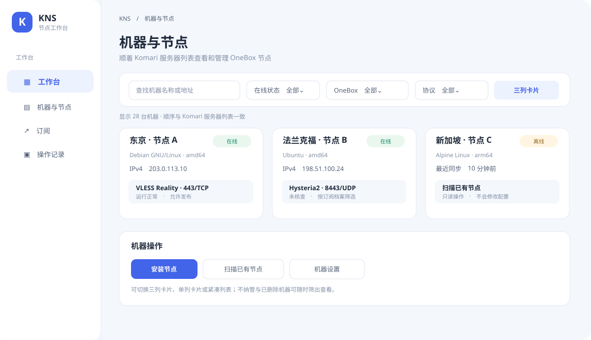
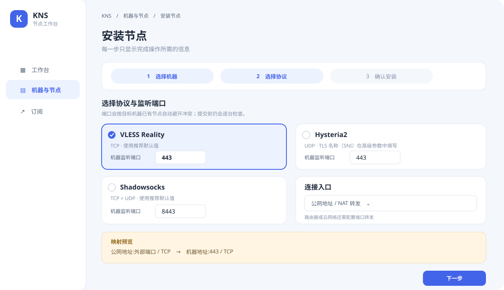
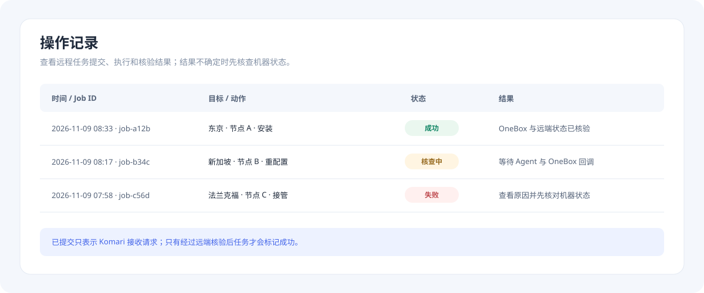
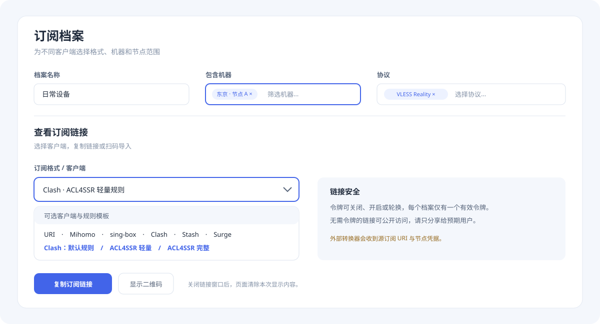

# Komari KNS

Komari KNS 是 Komari 的节点管理与订阅插件。你可以在一个页面里查看机器、管理 OneBox 节点、检查远程任务，并为不同客户端生成订阅链接。

## OneBox 项目介绍

OneBox 负责在 Linux 机器上安装和运行代理节点；KNS 通过 Komari 集中管理这些节点并生成订阅。请查看 [OneBox 项目介绍与使用文档](https://github.com/liuarui/onebox)。

> 下方是操作示意图。订阅地址、机器地址和节点凭据请勿公开分享。

## 工作台

机器按 Komari 服务器列表排序。你可以按在线状态、OneBox、协议和机器标签筛选，也可以切换三列卡片、单列卡片或紧凑列表。Komari 已删除的机器默认隐藏；需要查看保留的节点记录时，打开“显示已从 Komari 删除”。

## 安装节点

1. 在 Komari 插件管理中安装并启用 KNS，授予插件清单要求的权限。
2. 首次打开时填写探针可访问的 Komari HTTPS 地址。
3. 选择一台或多台在线机器，再选择协议、监听端口和连接入口。
4. 检查公网地址、NAT 外部端口和协议映射后提交。

远程安装权限默认开启，但不会自动安装。NAT 外部端口只用于生成订阅；还需要在路由器或云网络中配置公网端口到机器监听端口的转发。KNS 不会修改云安全组、路由器、DNS 或外部转发。

## 接管已有 OneBox 节点

在机器卡片上扫描已有节点。对受支持的旧节点选择“接管”，KNS 会保留节点协议、端口、凭据和 TLS 设置，将入站 tag 迁移为 KNS 管理的 tag，并登记实例清单。接管前会显示确认说明；操作会重载共享 sing-box 服务，同机其他节点可能短暂重连。配置校验、服务重载或回调失败时，OneBox 会尝试恢复原配置。

接管完成后可以在 KNS 中重配置、启停、重装、核查和卸载节点。多用户节点、不完整配置和不受支持的入站会显示原因，不会被自动改写。

## 任务状态

“操作记录”和机器卡片会显示 Agent 执行、OneBox 回调与远端状态核验结果。任务显示“已提交”只表示 Komari 已接收请求；请等状态变为成功或失败后再继续操作。结果不确定时，先核查机器状态。

## 订阅链接

创建订阅档案后，可以设置包含或排除的机器、协议和节点标签，决定是否过滤不健康节点，并选择输出格式。查看链接时可以选 URI、Mihomo、sing-box 或 SubConverter 客户端格式。Clash 还提供默认、ACL4SSR 轻量和 ACL4SSR 完整规则模板；规则模板由当前配置的 SubConverter 服务提供。

订阅令牌可以关闭、重新开启或轮换。每个档案仅有一个有效令牌，轮换后旧链接立即失效。无需令牌的档案适合公开分发：任何持有链接的人都能读取订阅。

外部 SubConverter 会收到原始订阅 URI 和节点凭据。请只配置自己信任的 HTTPS 转换服务；留空即可只使用 KNS 原生订阅。

## 运行要求

- Komari Server 支持 Node.js 插件、管理路由和系统 RPC。
- 目标机器启用了 Komari Agent 远程控制，Agent 以 root 运行。
- KNS 回调地址必须是探针可访问的 HTTPS 地址。
- OneBox 管理需要受支持的 Linux、systemd 或 OpenRC，以及 `jq`、`curl` 或 `wget` 等依赖。

## 项目与许可

- 当前正式版本：**1.0.0**。变更记录见 [CHANGELOG](CHANGELOG.md)。
- 许可： [GNU AGPL v3.0-only](LICENSE)。
- 插件安装包可从 [GitHub Releases](https://github.com/liuarui/komari-plugin-kns/releases) 下载。
